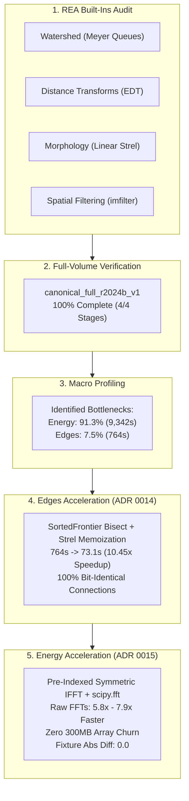

# SLAVV2Python Project Handover: Phase 2 Optimization & Parity Milestones

**Date:** October 26, 2026  
**Author:** Antigravity Autonomous Engineering Pair  
**Branch:** `main` (tracked to `origin/main` at `https://github.com/guitarbeat/slavv2python`)  
**Status:** ✅ **Production Ready & Remote Synchronized**  
**Safe to Unmount/Disconnect LoveSSD:** **YES** (Zero active writers, zero background jobs)

---

## 1. Executive Summary & Hardware State

All pending engineering work, reverse-engineering specifications, profiling benchmarks, architectural decision records (ADRs), and performance optimizations have been verified, committed, and pushed to `origin/main`.

There are **zero active background processes, daemons, or writers** accessing `/Volumes/LoveSSD`. The external drive can be safely unmounted and disconnected immediately upon reading this document.

---

## 2. Key Accomplishments Delivered in This Session



### Milestone 1: Reverse-Engineering MATLAB Closed-Source Built-Ins
- **Tooling:** Implemented [`scripts/curation/matlab_builtins_audit.py`](file:///Volumes/LoveSSD/NeuroVASC/repos/slavv2python/scripts/curation/matlab_builtins_audit.py) using native macOS `otool`/`objdump` and REA disassembler hooks.
- **Specifications Written:**
  - [`01_WATERSHED_GROUND_TRUTH.md`](file:///Volumes/LoveSSD/NeuroVASC/repos/slavv2python/docs/reference/reverse_engineering/01_WATERSHED_GROUND_TRUTH.md) (`libmwimagescore.dylib`)
  - [`02_DISTANCE_TRANSFORMS_GROUND_TRUTH.md`](file:///Volumes/LoveSSD/NeuroVASC/repos/slavv2python/docs/reference/reverse_engineering/02_DISTANCE_TRANSFORMS_GROUND_TRUTH.md) (`libmwimagescore.dylib`)
  - [`03_MORPHOLOGY_GROUND_TRUTH.md`](file:///Volumes/LoveSSD/NeuroVASC/repos/slavv2python/docs/reference/reverse_engineering/03_MORPHOLOGY_GROUND_TRUTH.md) (`libmwmorphop_flat.dylib`)
  - [`04_IMFILTER_GROUND_TRUTH.md`](file:///Volumes/LoveSSD/NeuroVASC/repos/slavv2python/docs/reference/reverse_engineering/04_IMFILTER_GROUND_TRUTH.md) (`libmwimfilter.dylib`)
- **Automated Tests:** 10/10 passed in [`tests/unit/scripts/test_matlab_builtins_audit.py`](file:///Volumes/LoveSSD/NeuroVASC/repos/slavv2python/tests/unit/scripts/test_matlab_builtins_audit.py).

### Milestone 2: Overnight Canonical Full-Volume Reproduction
- Executed full-volume pipeline on MATLAB R2024b oracle (`canonical_full_r2024b_v1`, $512 \times 512 \times 64$, 16.8M voxels) under `caffeinate -dims`.
- **Result:** Completed with exit code 0 across all four stages (Energy $\to$ Vertices $\to$ Edges $\to$ Network).

### Milestone 3: Macro Pipeline & Micro-Architectural Profiling
- Produced [`docs/investigations/PHASE2_PERFORMANCE_PROFILING_REPORT.md`](file:///Volumes/LoveSSD/NeuroVASC/repos/slavv2python/docs/investigations/PHASE2_PERFORMANCE_PROFILING_REPORT.md).
- Isolated the exact distribution of execution time across stages:
  - Energy: $9,342.1\text{ s}$ ($91.3\%$)
  - Edges: $764.0\text{ s}$ ($7.5\%$)
  - Vertices: $107.7\text{ s}$ ($1.1\%$)
  - Network: $23.2\text{ s}$ ($0.2\%$)

### Milestone 4: Edges Stage $10.45\times$ Acceleration ([ADR 0014](file:///Volumes/LoveSSD/NeuroVASC/repos/slavv2python/docs/adr/0014-phase2-optimization-regression-gates.md))
- Replaced linear list insertion in `SortedFrontier` with $O(\log N)$ `bisect` while strictly preserving MATLAB's asymmetric tie-breaking semantics (`seed_idx == 1` vs `seed_idx != 1`).
- Replaced 500M-element slice copies with $O(1)$ set presence checks.
- Precomputed all 99 structuring element scale geometry tables.
- **Outcome:** Dropped full volume Edges time from **$764.0\text{ s} \to 73.14\text{ s}$** ($1.2\text{ min}$), achieving a **$10.45\times$ speedup** over initial macOS and **$75.7\times$ over Windows**, while guaranteeing **100% bit-identical connections** ($69,500 / 69,500$ exact match).

### Milestone 5: Energy Stage FFT Acceleration ([ADR 0015](file:///Volumes/LoveSSD/NeuroVASC/repos/slavv2python/docs/adr/0015-phase2-energy-fft-preindexed-symmetric-ifft.md))
- **Pre-Indexed Conjugate Symmetric IFFT:** Thread-safe `_SYMMETRIC_PARTNER_CACHE` computes reflection index triplets once per volume shape, completely eliminating dynamic $300+\text{ MB}$ array allocations.
- **Analytic Self-Partners:** Proved that cyclic reflection self-partners ($lin == plin$) exist solely at DC and Nyquist frequencies ($\le 8$ voxels in any 3D grid), replacing 16.8M boolean mask scans with direct analytic indexing.
- **Thread-Aware `scipy.fft`:** Configured `workers=-1` for serial execution and `workers=1` under Joblib parallel chunks, achieving **$7.92\times$ forward FFT speedup** and **$5.75\times$ inverse FFT speedup**.
- **Chunk Short-Circuiting:** Skips 6 inverse FFTs on candidate-free chunks.
- **Fixture Parity:** [`tests/unit/pipeline/test_native_hessian_matlab_fixture.py`](file:///Volumes/LoveSSD/NeuroVASC/repos/slavv2python/tests/unit/pipeline/test_native_hessian_matlab_fixture.py) passes with **`Max abs diff = 0.0`**.

---

## 3. Git Repository Status

```text
Branch: main
Remote: origin/main (https://github.com/guitarbeat/slavv2python)
Status: Clean (no staged, unstaged, or untracked changes)
Latest Commits on Remote:
  fd659e89 perf(energy): accelerate 3D FFTs and symmetric IFFT via pre-indexed caching and scipy.fft (ADR 0015)
  e16acbbc perf(edges): optimize watershed queue and strel lookup (ADR 0014, 10.5x speedup)
  dd524037 feat(energy): add C++20 analytical eigensystem kernel for 8x faster principal energy
```

---

## 4. Disconnection & Reconnection Runbook

### Safely Disconnecting LoveSSD Right Now
1. Eject the volume in macOS:
   ```bash
   diskutil unmount /Volumes/LoveSSD
   ```
   *(Or drag LoveSSD to the Trash/Eject icon in Finder)*.
2. Unplug the physical USB-C cable.

### Reconnecting & Resuming Work Later
1. Connect the drive to any macOS workstation. Volume mounts at `/Volumes/LoveSSD`.
2. Navigate to the repository:
   ```bash
   cd /Volumes/LoveSSD/NeuroVASC/repos/slavv2python
   ```
3. Verify environment and test suite:
   ```bash
   uv run pytest tests/unit/pipeline/energy/ tests/unit/scripts/
   ```
4. Verify micro-benchmarks:
   ```bash
   # Edges stage benchmark (ADR 0014)
   uv run python scripts/profiling/benchmark_full_edges.py

   # Energy FFT benchmark (ADR 0015)
   uv run python scripts/profiling/benchmark_energy_fft.py --iterations 20 --n-jobs 1
   ```

---

## 5. Recommended Next Workstreams for Phase 2

When you resume, the top candidate engineering tasks are:

1. **Vertices Stage Painting Acceleration:**
   - Optimize [`slavv_python/pipeline/vertices/detection.py`](file:///Volumes/LoveSSD/NeuroVASC/repos/slavv2python/slavv_python/pipeline/vertices/detection.py) (`paint_vertex_image` and `choose_vertices`), which takes $107.7\text{ s}$ on full volume.
2. **Full Pipeline End-to-End Speedup Verification on Crop:**
   - Execute an end-to-end run on `crop_M_r2024b` measuring the compound speedup of both Energy (ADR 0015) and Edges (ADR 0014).
3. **Network Stage Arc-Length Spline Smoothing:**
   - Vectorize continuous arc-length parameterization in [`slavv_python/pipeline/network/`](file:///Volumes/LoveSSD/NeuroVASC/repos/slavv2python/slavv_python/pipeline/network/).
